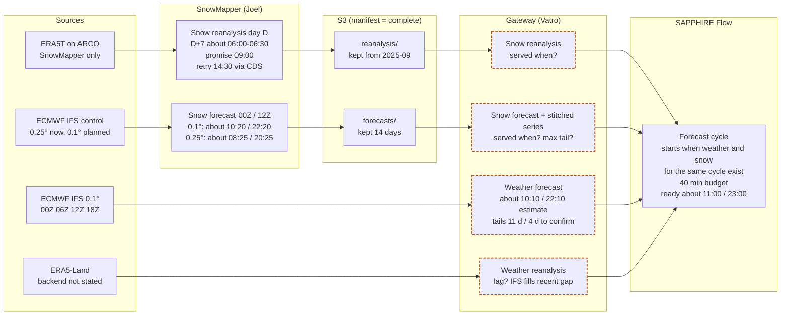

# SnowMapper → Data Gateway → forecast tools

Draft v0.6 · 17 November 2026 · Maintainer: Bea Marti

This agreement defines the snow files, the gateway output and the handover needed
to use them. **Next milestone: representative 00Z and 12Z forecast files and one
reanalysis day in the agreed format.**

00Z and 12Z mean forecasts initialized at 00:00 and 12:00 UTC, not their delivery
times. A forecast “tail” is the future part appended to the historical series.

**Status:** confirmed points below are carried forward from the source discussions;
other delivery requirements are proposed for Joel and Vatro to confirm. This draft
does not replace the [existing Nepal gateway agreement](01-data-gateway-requirements.md)
or authorize a live switch. Confirmations are Bea's record of discussions, not
new supplier sign-off on this draft.

## 1. Data contract

| Item | Required delivery | Status |
| --- | --- | --- |
| Source | One merged NetCDF mosaic at `s3://snow-model-data-source/joel-snow-model-mosaic/` | Confirmed: Joel, 6/11 Nov |
| Forecast | Control run, 00Z and 12Z cycles, uniformly 3-hour output through a 240-hour horizon | Control confirmed; Joel confirms cycles, step and horizon |
| Reanalysis | Daily files; history from 2025 on S3; longer training history offline | History route confirmed: Joel, 11 Nov; SnowMapper delivers day D on D+7, usually ≈ 03:00 (Joel, 19 Nov; see Schedule). Gateway serving time: Vatro to state |
| Variables | `swe`: snow water equivalent in mm at the timestamp. `rof`: mm over the following interval, not a running accumulation | Proposed; Joel states whether `rof` includes rainfall as well as snowmelt |
| Time | UTC, start stamps: `rof` at 00:00 covers [00:00, 03:00); `swe` at 00:00 is the state at 00:00 | Start stamps confirmed: Joel and Vatro, 11 Nov; example assumes 3-hour output |
| Gateway output | One requested variable, UTC timestamps, one column per registered polygon, and each row's dataset (`source`) and producing cycle/date (`source_run`); retain source units and time step | Existing output structure; Vatro confirms new-file handling |
| Gateway processing | No further time shift or differencing. Same spatial statistic and missing-cell policy for history and forecasts; missing is never zero | Required by forecast tools; Vatro documents the existing method or any necessary change |
| Mosaic handling | Crop for each deployment through one data flow; stitch from two daily cycles | Cropping and two-cycle feasibility confirmed: Vatro, 9/11 Nov |

A gateway **HRU** is a registered geometry file and may contain several polygons
(catchments or elevation bands),
per the [existing agreement](01-data-gateway-requirements.md#1-context--the-agreed-division).
The agreed exclusion of a 00:00 value belonging to the previous day must not exclude
a valid start-stamped interval [00:00, 03:00).

## 2. Responsibilities on our side

- **Bea maintains this agreement and integrates the forecast tools.** We request
  exact forecast cycles: the gateway must return that cycle or report it unavailable.
  We do not silently substitute, fill missing values or extend an exhausted tail.
- **Forecast tools own daily aggregation.** The recorded provisional Nepal operating
  day is **18:00–18:00 UTC**, or **23:45–23:45 Nepal time**: it starts 15 minutes
  before civil midnight, without shifting source timestamps. Bea clarifies the daily
  boundary and how SWE is summarized with Sandro. Only after that discussion will
  Bea reconcile the plans and check that training and forecasts use the agreed
  convention. The 18:00 boundary is not implemented in the current
  shared resampler; this draft does not claim otherwise.
- **Bea handles scope and migration.** We supply the required deployment areas,
  check existing consumers before dropping snow depth (`hs`), and set forecast-run times from
  confirmed delivery times. No new regional coverage is assumed.
- **Bea owns acceptance and cutover**, including the integration checks and parallel
  run in both deployments, with Sandro's model acceptance before switching.
  Proposed supplier condition: old streams remain available until Bea approves.

## 3. Only three handovers to arrange

Each owner supplies a delivery date with their response. Preparatory integration
can proceed in parallel; operational arrangements need not delay the first samples.

| Owner | What we need |
| --- | --- |
| **Joel — files and samples** | Supply the forecast and reanalysis samples with the short file specification below; confirm forecast coverage, runoff meaning and whether the uploaded history matches. Delivery times are given in the Schedule; confirm they hold after the 0.1° switch. |
| **Vatro — gateway delivery** | Verify the samples, state when each cycle is served, and document how polygon values are calculated, missing cells handled, and history joined to forecasts, including the selected tail and maximum age of fallback data. With Joel, specify complete-upload detection and recovery of missed ingests or revised history. |
| **Sandro — model inputs** | Confirm runoff suitability, daily boundary/SWE aggregation, and the training period, variables and resolution needed from Joel. Accept the retrained models against the current models before cutover. |

For an operational stitched series, an older **complete** run may be used only
within the documented age and coverage limits, with its actual cycle in
`source_run`; otherwise report unavailable data. This does not permit substitution
on an exact-cycle request. Retention must support ingestion recovery and the
reanalysis gap; the reported decision against a long-term cloud forecast archive
does not remove that requirement. Joel's “latest run only” proposal needs to fit it.

Joel and Vatro remain the contacts for their services; Bea monitors the forecast
side. Delivery deadlines define lateness. Planned outages are proposed to be
announced in `#data-gateway`. Changes to the agreed interface require updated
samples before rollout.

## File specification accompanying the samples

Joel documents the format; Vatro checks that it is ingestible. The accepted samples
and accompanying specification define the file layout, including forecast object
keys. Use these to settle the details rather than separate meetings for each:

- Keys distinguish run date **and hour**; identify initialization, valid times and
  lead times. Reanalysis currently uses `reanalysis/param=<var>/run_date=YYYYMMDD/`.
- Record grid/CRS, extent, coordinates, units, CF metadata, missing-value encoding
  and packing. Include explicit interval bounds or an unambiguous equivalent.
- State first/last intervals and states, including whether SWE includes +240 h.
  A 240-hour forecast has 3-hour runoff interval starts +0 through +237 h.
- Explain output beyond +144 h, where IFS inputs become 6-hourly; preserve totals
  if redistributing intervals. Identify the source/model version and reanalysis revisions.

## Schedule

All times are **UTC**. Deployment-local deadlines are configuration, not part of this
agreement (see “Local deadlines”). Joel's delivery times are for the 0.1° forecast.
The gateway already serves 0.1° IFS weather (confirmed, 19 Nov); SnowMapper snow (Joel) switched
to 0.1° with the 19 Nov 00Z cycle, delivered 10:29. A cycle counts as delivered only when its manifest exists on S3.

### Data flow

Dashed boxes are gateway behaviour Vatro has still to state or confirm. Snow takes two
hops (SnowMapper, then S3) before the gateway; weather goes straight to the gateway.
Edit this diagram as answers arrive.

### Delivery chain

| Step | Reanalysis day D | 00Z cycle | 12Z cycle |
| --- | --- | --- | --- |
| Source data complete | SnowMapper only: ERA5T for D+1 complete on ARCO at D+7, ≈ 02:50 (19 Nov) | ≈ 09:35 | ≈ 21:35 |
| SnowMapper → S3 (usual) | ≈ 03:00 on D+7 | ≈ 10:30 | ≈ 22:30 |
| SnowMapper → S3 (promise) | 09:00 on D+7 | 12:00 (init + 12 h) | 00:00 (init + 12 h) |
| Gateway weather (IFS) | not applicable | ≈ 10:10 typical; plan for 12:00 | ≈ 22:10 typical; plan for 00:00 |
| Gateway snow served | Vatro to state | Vatro to state | Vatro to state |
| Gateway weather reanalysis (ERA5-Land) | Vatro to state; SnowMapper's ARCO timing does not apply | not applicable | not applicable |
| Forecast tools run | not on critical path | see below | see below |
| Forecast cycle budget | — | 40 min | 40 min |
| Forecast ready for reviewers (usual / at the promise) | — | ≈ 11:00 / 12:40 | ≈ 23:00 / 00:40 |

Weather is delivered four times a day (00Z, 06Z, 12Z, 18Z; 06Z/18Z about 6 h after
the 00Z/12Z times above); snow twice. The weather “typical” times are Bea's
estimate (about 10 h plus about 10 min of gateway processing); Vatro confirms.
The older gateway agreement assumed 7–8 h.
SnowMapper's reanalysis day D is complete only once ERA5 for the start of D+1 is on
ARCO, which uploads a day's files over a few hours from 00:10; SnowMapper starts once the whole
day is there (19 Nov: 02:50, delivered 02:56). If ARCO lacks a file, SnowMapper's 14:30 retry fetches it from CDS, so that
day arrives in the afternoon of D+7. These times describe SnowMapper only. The gateway's
weather reanalysis is ERA5-Land, not SnowMapper's ERA5T/ARCO route; its backend and lag
are for Vatro to state.

Reanalysis day D is not needed by SnowMapper's forecast run:
- **Snow:** the days between the last reanalysis day and the forecast start come from
  stitching successive cycles. SnowMapper keeps 14 days; the gateway's maximum snow tail
  is not confirmed (Vatro), and the bridge is guaranteed only up to that tail.
- **Weather:** the gateway fills the recent ERA5-Land gap with IFS forecast data
  (`source` = `ifs`). The fill window is set by the gateway (Vatro to state). Selectable weather
  tails (separate from the fill window): 11 days for 00Z/12Z (requested, Vatro to confirm), 4 days for 06Z/18Z (reported confirmed, Vatro, 13 Nov). The 00Z
  horizon is 10 days observed versus about 15 documented; Vatro to reconcile.

A late or missing reanalysis day therefore does not delay the forecast on SnowMapper's
side; whether the gateway can bridge it depends on the tails above.

### Forecast runs

| Forecast | Issued from | Trigger | Status |
| --- | --- | --- | --- |
| **Daily (baseline)** | 12Z cycle, once a day | Weather and snow manifests for the same 12Z cycle exist | Proposed |
| Daily update (optional) | 00Z cycle, about 12 h later | Same, per organisation request | Proposed, off by default |
| **Sub-daily** | All four weather cycles | Exact weather cycle available; snow from the latest complete snow cycle | Proposed |

- **Trigger on data, not the clock.** The daily forecast targets 07:00 local as a
  *deadline*; a run starts when its inputs exist, not at a fixed time.
- **Sub-daily snow age.** The 06Z and 18Z weather cycles use the snow cycle
  initialised 6 h earlier (00Z and 12Z respectively), recorded in `source_run`.
  Vatro confirms the maximum age; beyond it, report unavailable.
- **No substitution on exact-cycle requests.** A missing cycle is reported, never
  replaced; the previous forecast stays visible and is labelled with its cycle.

### Local deadlines

Each deploying organisation sets its own daily deadline as a local clock time with a
named timezone (for example 07:00 `Asia/Kathmandu`; 09:00 or noon are equally valid).
The table below uses 07:00 as an illustration of the tightest case. Servers and
schedules run on UTC; only the deadline is converted from local time.

**Daylight saving.** Nepal and the Central Asian deployments listed here do not use
daylight saving, so their UTC deadlines are fixed. SnowMapper, the gateway and the
delivery times above are UTC and never shift. A deployment in a timezone that does
observe daylight saving would see its UTC deadline move by an hour twice a year,
because the deadline is stored as local time; the data times do not move, so the
margin shrinks or grows by that hour.

**Rule for the forecast system.** Polling starts, retries and run triggers are
defined relative to the UTC cycle time (init + N h) and do not depend on the server's
clock or timezone; schedules and containers are pinned to UTC. Only the deadline
check and the display of results use the deployment's named timezone. Forecast days
stay fixed 24-hour days with a boundary set per deployment, so daylight saving never
creates 23- or 25-hour days. Sandro will state the time zone each model is trained in
and expects as input (see open items); a daily model's training and operating day
must use the same boundary. A deployment that runs its server on local time must still get the
same behaviour; this is to be verified before relying on it.

The binding constraint is the daily 12Z forecast: data is promised at 00:00 and the
forecast must be ready by the local deadline.

| Deployment | UTC offset | 07:00 local | Time after the 00:00 promise |
| --- | --- | --- | --- |
| Kyrgyzstan | +6 | 01:00 | 60 min |
| Nepal | +5:45 | 01:15 | 75 min |
| Tajikistan, Uzbekistan, Kazakhstan, Turkmenistan | +5 | 02:00 | 120 min |

The budget covers one forecast cycle plus handover to reviewers. A forecast cycle is
budgeted at **40 minutes** (MVP target; about 30 minutes in the long run). The Nepal
cycle takes about 25 minutes today; the budget leaves room for models still to be
onboarded. If data arrives exactly at the promise, the forecast is ready at 00:40,
leaving 20 min (Kyrgyzstan), 35 min (Nepal) or 80 min (+5 countries) for the review
handover. Usual delivery is about 1 h 40 earlier than the promise, so these margins
are normally larger. The reviewer hand-over lag is open (see below). Daily boundaries for the non-Nepal deployments are not yet defined.

### Retries and alerts

Approved by Bea on 17 Nov as the starting policy; to be tuned from observed
delivery times.

- Per cycle, start polling at init + 10 h and repeat every 15 min until init + 14 h
  (promise plus 2 h of grace); then hourly until the next cycle of that type supersedes it.
- Each run is given its exact cycle time and is idempotent: a cycle is processed once.
  Do not rely on the scheduler's cron time for the cycle.
- Alert once at init + 14 h if the cycle is still missing, and once on recovery.
- The next scheduled cycle proceeds independently; one late cycle never blocks it.

### Gaps to settle with Vatro

What the gateway documentation and the SnowMapper documentation already say, and what
is still missing. Sources: the
[gateway client README](https://github.com/hydrosolutions/recap-dg-client/blob/main/README.md)
and the [SnowMapper data gateway page](https://apps.mountainfutures.ch/snowmapper/docs/operational/data-gateway/).

| Topic | Already documented | Gap for Vatro |
| --- | --- | --- |
| Polygon values and missing cells | Client README, “Data semantics”: raw values, caller chooses the daily aggregation; `allow_missing_data` option. SnowMapper docs: files use fill value −32768 (int16; −9999 for Central Asia) and NaN outside the domains | **No statement of the spatial statistic or how missing cells enter it.** We need the same statistic and policy for history and forecasts, and missing never zero |
| History joined to forecasts | Client README, “Provenance”: `source` and `source_run` per row; IFS fills the recent ERA5 gap. SnowMapper docs: the gateway stitches successive cycles for `snow.operational` | Selected tail, maximum age of fallback data, and the gateway's snow tail (SnowMapper keeps 14 days) |
| New-format files | Not documented | Confirm the gateway ingests the new mosaic format without change |
| Missing cycle | SnowMapper docs: a cycle that cannot be produced gets no manifest and is not replaced by an older one. Client README: missing source data raises `ApiDataUnavailableError` | Does the gateway report a missing cycle per cycle, and does it never serve an older one in its place |
| Complete upload and recovery | SnowMapper docs: a day or cycle is complete only when its manifest exists; reanalysis retried at 14:30 | **No procedure for missed ingests or revised history** (Joel with Vatro) |
| Serving times | None | Snow reanalysis, snow forecast and weather serving times; ERA5-Land lag; IFS fill window |
| Timestamp convention of served ERA5-Land values | Measured 19 Nov, HRU 12300 (`g_123`, 99.7 km²), 30 Oct–1 Nov, against an exactextract coverage-weighted mean of ERA5-Land from CDS: 2 m temperature matches exactly at the same stamp (RMSE 0.0001 K). Hourly precipitation matches exactly (RMSE 0) the ERA5-Land increment that *ends* one hour later, so the gateway stamps precipitation at the interval start (ERA5-Land natively stamps at the end). Spatial averaging agrees with exactextract. One basin, three days | Vatro to confirm the convention (start-stamped increments for accumulated variables) and document it in the client README. Consumers must not treat precipitation stamps as interval ends |

### Open items

| Owner | Question |
| --- | --- |
| Vatro | Gateway weather and snow serving times; ERA5-Land reanalysis lag and IFS gap-fill window; maximum snow tail; weather tail for 00Z/12Z (11 days requested); maximum snow age for the 06Z/18Z runs; whether the gateway reports a missing cycle explicitly |
| Joel | Times confirmed after SnowMapper's switch to 0.1° (first 0.1° cycle 19 Nov 00Z, on S3 10:29); announce changes in `#data-gateway` |
| Sandro | State the time zone and daily boundary each model is trained in and expects as input, per deployment. This matters for daily models: a model trained on UTC days does not produce Nepal-day output, so Nepal daily forecasts need models trained on Nepal-day boundaries (the provisional 18:00–18:00 UTC day in section 2) |
| Bea | Estimate reviewer hand-over lag; check the 40-minute cycle budget holds as models are onboarded; daily boundaries per deployment |

**Sources:** Bea's v0.3 draft (13 Nov), reporting Joel/Vatro discussions from
7 Sep–13 Nov; Joel's delivery times (17 Nov) and the
[SnowMapper operational docs](https://apps.mountainfutures.ch/snowmapper/docs/operational/);
[gateway README](https://github.com/hydrosolutions/recap-dg-client/blob/main/README.md);
[ECMWF input steps](https://www.ecmwf.int/en/forecasts/datasets/open-data).
The [internal notes](05-snowmapper-gateway-follow-ups.md) retain the time-decision
references and separate weather work. Discussion confirmations have not been
independently reconfirmed.
