# Database Schema

Entity-relationship diagrams for the SAPPHIRE Flow PostgreSQL database.
Derived from table definitions in `architecture-context.md` and scoping rules in `v0-scope.md`.

### CHWRR publication extension (migrations 0063–0064, Plan 341 T2/T2b)

The later CHWRR extension adds six tables without removing or changing any
`forecasts` columns. `forecast_publication_selections` has primary key
`(tenant_id, station_id, parameter, issued_at)`, a nullable selected forecast
ID and an independent monotonic version. Composite foreign keys bind its
tenant to the station and its selected forecast to the exact station,
parameter and issue time. The empty row remains after withdrawal.

`forecast_publication_decisions` retains immutable per-forecast publish,
replacement and reasoned withdrawal records. Its actor/tenant/action/key
unique constraint supports idempotent replay; a forecast ID can be withdrawn
once and cannot be republished. `forecast_publication_events` keeps immutable
feed events, with numbers allocated transactionally through the singleton
`forecast_publication_sequence`. `audit_log` receives the same action in the
same transaction. Neither `ForecastStatus` nor forecast values are changed.

`protected_backup_health` is a singleton host-written projection of the
latest verified restore, target separation, retention readiness and check
time. Migration 0064 adds pending and overdue counts, oldest pending time, last
backup attempt time and retry due time (`next_retry_at`)
and failed forecast IDs. `protected_backup_forecast_proofs` holds append-only per-forecast
host assessments; a composite FK binds each proof to the exact attestation,
forecast and backup. A fresh assessment can point to the same attestation;
old proof rows do not satisfy a later publication decision: migration 0064
links each new proof to the exact decision ID captured in the dump. T2b fills the projection for every pending
published forecast in the restored dump. The FK also makes a bare
`TRUNCATE` of an attestation table fail before its append-only trigger; a
`TRUNCATE ... CASCADE` requires privileges on the protected proof table.
An eligible captured forecast can record `backup_pending`
only behind healthy global backup state; an overdue proof blocks new publish
writes and creates a CRITICAL operations-health record. All CHWRR publication
API paths and activation remain later Plan 341 tasks.

### Rejected forecasts (migration 0065, Plan 404 T1)

`rejected_forecasts` records a QC-rejected member or group-station forecast
outside `forecasts` (D1/D2) — a `QC_FAILED` assignment is never stored as a
forecast. One row per rejected parameter, keyed by
`(attempt_id, station_id, model_id, group_id, parameter)` in practice
(`attempt_id` distinguishes a Plan 327 resume or Plan 328 retry of the same
cycle); `group_id` is `NULL` for a member (station) rejection. `values` is
JSONB, keyed by member id or quantile level, each an array of
`[valid_time, value]` pairs with the evidence non-finite encoding
(`services/forecast_evidence.py`); `qc_status` is the parameter's own
verdict (`qc_failed`, `qc_suspect`, `qc_passed`, or `qc_unchecked` when its
QC/datum handling errored after an earlier parameter in the same assignment
had already failed). Append-only: role-independent triggers reject UPDATE,
DELETE and TRUNCATE even for the table-owning role, mirroring migration
0057's `forecast_evidence` guard. `sapphire_worker` retains INSERT. Revision `0071`
and bootstrap grant API/worker SELECT only on explicit safe columns, excluding
`input_lineage`; STANDARD stores project NULL instead of reading that column.
Owner and approved backup access remain unchanged. Not in the ER
diagrams below (append-only/evidence-style tables are narrated here rather
than diagrammed, matching `forecast_evidence`'s own precedent).

---

## v0 Schema (27 tables)

This section preserves the original v0 scope. Later migrations added rating curves
and curve references; the current schema is described in the full-schema sections below.

Swiss public data, up to ~170 stations (LINDAS-available BAFU gauges), single VM. Architecture supports ~1000 stations across deployments. No partitioning, no auth, no rating curves,
no forecast adjustments, no DLQ, no cold storage. See `v0-scope.md` §A–C for rationale and plan 013 for scale re-evaluation.

**Differences from full schema** (marked with `v0▸` below):
- `observations`: no `rating_curve_id`, no `rating_curve_correction_version` columns
- `weather_forecasts`: no `is_gap`, no `gap_status` columns (Flow 11 deferred)
- `model_artifacts.status`: only `training | active | superseded` (no approval gate)
- `forecasts.model_artifact_id`: nullable (`UUID NULL`) — combined forecasts have no artifact. Also adds `combination_strategy TEXT NULL` and `source_model_ids JSONB NULL` (v0b, Plan 026)
- `skill_scores.model_artifact_id` and `skill_diagrams.model_artifact_id`: nullable (`UUID NULL`) — combined-model skill rows use `NULL` (v0b, Plan 026)
- `models.artifact_scope`: CHECK constraint includes `'virtual'` for sentinel combination models (`_pooled`, `_bma`, `_consensus`) (v0b, Plan 026)
- No table partitioning anywhere
- 8 tables removed entirely (see "Not in v0" below)
- `tenants` + station tenant IDs (Plan 147 Slice A), `audit_log` (Slice B), and `access_tokens` + `access_token_stations` (Slice C, migration 0047) are realized. The access-token schema uses an HMAC-SHA-256+pepper hash and normalized station scopes; it has no `users` FK. Plan 401 adds the reviewer token role (migration 0061). Plan 341 T1 adds minimal local `users`, external identities, and station grants (migration 0062). These later additions extend the original v0 schema diagram below; `refresh_tokens` and password/session login remain deferred.

```mermaid
erDiagram
    %% ──────────────────────────────────────────────
    %% REFERENCE DATA
    %% ──────────────────────────────────────────────

    parameters {
        TEXT name PK "canonical name"
        TEXT display_name
        TEXT unit
        TEXT parameter_domain "river | weather | water_quality | groundwater | soil"
        TEXT aggregation_method "sum | mean"
        TIMESTAMPTZ created_at
    }

    %% ──────────────────────────────────────────────
    %% STATION DOMAIN
    %% ──────────────────────────────────────────────

    %% Plan 147 Slice A: tenant-model foundation. Seeded with a default
    %% `sapphire` tenant (migration 0041) so existing single-tenant Swiss
    %% data backfills onto it — this is the ROOT of the v1.0 auth/RBAC
    %% foundation, landed early as a pure data-model slice (no auth yet).
    tenants {
        UUID id PK
        TEXT code UK "human/config handle, e.g. sapphire, dhm"
        TEXT name
        TIMESTAMPTZ created_at
    }

    basins {
        UUID id PK
        TEXT code "UK (network, code)"
        TEXT network "NOT NULL"
        TEXT name
        GEOMETRY geometry "MULTIPOLYGON 4326"
        DOUBLE_PRECISION area_km2 "NULL"
        JSONB attributes "NULL — catchment attrs"
        TEXT regional_basin "NULL — display grouping"
        JSONB band_geometries "NULL — elevation bands"
        TIMESTAMPTZ created_at
    }

    stations {
        UUID id PK
        TEXT code "UK (network, code)"
        TEXT name
        GEOMETRY location "POINT 4326"
        DOUBLE_PRECISION altitude_masl "NULL"
        DOUBLE_PRECISION water_level_datum_masl "NULL"
        TEXT water_level_unit "NULL"
        TEXT station_kind "weather | river | lake"
        UUID basin_id FK "NULL"
        TEXT timezone "IANA"
        TEXT regulation_type "NULL"
        TEXT_ARRAY forecast_targets "NULL"
        TEXT_ARRAY measured_parameters
        TEXT station_status "default onboarding"
        TEXT network "NOT NULL"
        TEXT ownership "default own"
        TEXT wigos_id "NULL"
        TEXT gauging_status "default gauged"
        TIMESTAMPTZ created_at
        TIMESTAMPTZ updated_at
        UUID tenant_id FK "NOT NULL, canonical (R4) — UK (id, tenant_id)"
    }

    station_thresholds {
        UUID station_id PK, FK
        TEXT danger_level PK
        TEXT parameter PK
        DOUBLE_PRECISION value
        TEXT source "authority | inferred"
        TIMESTAMPTZ created_at
        TIMESTAMPTZ updated_at
    }

    station_weather_sources {
        UUID station_id PK, FK
        TEXT nwp_source PK
        TEXT extraction_type "point | basin_average | elevation_band"
        TEXT status "active | inactive, default active"
        TEXT role "forecast | reanalysis, NULL until 115c cleanup (rev TBD)"
    }

    station_groups {
        UUID id PK
        TEXT name "UK (tenant_id, name) — NOT globally unique"
        TEXT description "NULL"
        TIMESTAMPTZ created_at
        UUID tenant_id FK "NOT NULL — UK (id, tenant_id)"
    }

    station_group_members {
        UUID group_id PK, FK
        UUID station_id PK, FK
        TIMESTAMPTZ created_at
        UUID tenant_id "NOT NULL — 2 composite FKs force it to equal both the station's and group's tenant_id"
    }

    stations ||--o| basins : "basin_id"
    stations ||--o{ station_thresholds : "station_id"
    stations ||--o{ station_weather_sources : "station_id"
    stations ||--o{ station_group_members : "station_id"
    station_groups ||--o{ station_group_members : "group_id"
    tenants ||--o{ stations : "tenant_id"
    tenants ||--o{ station_groups : "tenant_id"

    %% ──────────────────────────────────────────────
    %% OBSERVATION DOMAIN
    %% Historical v0-only sketch; later migrations added curve references and rating_curves.
    %% v0: not partitioned (plan 013: ~8.9M rows/year at ~170 stations, ~52.6M at ~1000 — ~6×)
    %% ──────────────────────────────────────────────

    observations {
        UUID id PK
        UUID station_id FK
        TIMESTAMPTZ timestamp
        TEXT parameter
        DOUBLE_PRECISION value "NULL when missing"
        TEXT source "measured | manual_import"
        TEXT qc_status "raw | qc_passed | qc_failed | qc_suspect | missing | qc_unchecked"
        JSONB qc_flags
        TEXT qc_rule_version "NULL"
        TIMESTAMPTZ created_at
    }

    stations ||--o{ observations : "station_id"

    %% ──────────────────────────────────────────────
    %% WEATHER / NWP DOMAIN
    %% v0: no is_gap, no gap_status (Flow 11 deferred)
    %% v0: not partitioned (plan 013: negligible volume vs forecast_values)
    %% ──────────────────────────────────────────────

    weather_forecasts {
        UUID id PK
        UUID station_id FK
        TEXT nwp_source
        TIMESTAMPTZ cycle_time
        TIMESTAMPTZ valid_time
        TEXT parameter
        TEXT spatial_type "point | basin_average | elevation_band"
        INT band_id "NULL"
        INT member_id "NULL"
        DOUBLE_PRECISION value
        TIMESTAMPTZ created_at
    }

    stations ||--o{ weather_forecasts : "station_id"

    %% ──────────────────────────────────────────────
    %% HISTORICAL FORCING DOMAIN
    %% ──────────────────────────────────────────────

    historical_forcing {
        UUID id PK
        UUID station_id FK
        TEXT source "camels-ch | era5 | era5-land | smn"
        TEXT version "dataset version tag"
        TIMESTAMPTZ valid_time
        TEXT parameter
        TEXT spatial_type "point | basin_average | elevation_band"
        INT band_id "NULL"
        INT member_id "NULL — deterministic | control | ensemble"
        DOUBLE_PRECISION value
        TIMESTAMPTZ created_at
    }

    stations ||--o{ historical_forcing : "station_id"

    %% ──────────────────────────────────────────────
    %% MODEL DOMAIN
    %% v0: model_artifacts.status = training | active | superseded only
    %% v0b: models.artifact_scope includes 'virtual' for sentinel combination rows
    %% ──────────────────────────────────────────────

    models {
        TEXT id PK "entry point name, or sentinel _pooled/_bma/_consensus"
        TEXT display_name
        TEXT artifact_scope "station | group | virtual"
        TEXT description
        TIMESTAMPTZ created_at
    }

    model_artifacts {
        UUID id PK
        TEXT model_id FK
        UUID station_id FK "NULL — station-scoped"
        UUID group_id FK "NULL — group-scoped"
        TEXT status "v0: training | active | superseded"
        TEXT artifact_path
        TEXT artifact_sha256 "integrity check"
        TIMESTAMPTZ training_period_start
        TIMESTAMPTZ training_period_end
        TIMESTAMPTZ trained_at
        TIMESTAMPTZ promoted_at "NULL"
        UUID promoted_by "NULL"
        TIMESTAMPTZ superseded_at "NULL"
        TIMESTAMPTZ created_at
    }

    model_assignments {
        UUID station_id PK, FK
        TEXT model_id PK, FK
        INTERVAL time_step
        TEXT status "active | inactive"
        INT priority "default 0"
        TIMESTAMPTZ created_at
    }

    group_model_assignments {
        UUID group_id PK, FK
        TEXT model_id PK, FK
        INTERVAL time_step
        TEXT status "active | inactive"
        INT priority "default 0"
        TIMESTAMPTZ created_at
    }

    model_states {
        UUID id PK
        UUID station_id FK
        TEXT model_id FK
        TIMESTAMPTZ issue_time
        BYTEA state_bytes
        TIMESTAMPTZ created_at
    }

    models ||--o{ model_artifacts : "model_id"
    models ||--o{ model_assignments : "model_id"
    models ||--o{ group_model_assignments : "model_id"
    models ||--o{ model_states : "model_id"
    stations ||--o{ model_artifacts : "station_id"
    station_groups ||--o{ model_artifacts : "group_id"
    stations ||--o{ model_assignments : "station_id"
    station_groups ||--o{ group_model_assignments : "group_id"
    stations ||--o{ model_states : "station_id"

    %% ──────────────────────────────────────────────
    %% FORECAST DOMAIN
    %% v0: not partitioned (plan 013: ~3.7B forecast_values rows/year at ~1000 stations; see v0-scope §A1 DECISION)
    %% v0: no forecast_adjustments table
    %% v0b: forecasts.model_artifact_id nullable; combination_strategy + source_model_ids added (Plan 026)
    %% ──────────────────────────────────────────────

    forecasts {
        UUID id PK
        UUID station_id FK
        TEXT model_id FK
        UUID model_artifact_id FK "NULL for combined forecasts"
        TIMESTAMPTZ issued_at
        TIMESTAMPTZ nwp_cycle_reference_time
        TEXT nwp_cycle_source "primary | fallback"
        TEXT parameter
        TEXT units
        TEXT representation "members | quantiles"
        TEXT status "default raw"
        INT version "default 1"
        TEXT warm_up_source "NULL"
        DOUBLE_PRECISION warm_up_state_age_hours "NULL"
        DOUBLE_PRECISION observation_staleness_hours "NULL"
        TEXT qc_status "default raw"
        JSONB qc_flags "default empty"
        TEXT combination_strategy "NULL for individual; pooled|bma|consensus for combined"
        JSONB source_model_ids "NULL for individual; [model_id, ...] for combined"
        TIMESTAMPTZ created_at
        TIMESTAMPTZ updated_at
    }

    forecast_values {
        UUID id PK
        UUID forecast_id FK
        TIMESTAMPTZ issued_at "denorm — not partitioned in v0"
        TIMESTAMPTZ valid_time
        INT lead_time_hours
        INT member_id "NULL"
        DOUBLE_PRECISION quantile "NULL"
        DOUBLE_PRECISION value
    }

    hindcast_forecasts {
        UUID id PK
        UUID station_id FK
        TEXT model_id FK
        UUID model_artifact_id FK
        TIMESTAMPTZ hindcast_step "simulated issue time"
        TEXT forcing_type "nwp_archive | reanalysis"
        TEXT representation "members | quantiles"
        UUID hindcast_run_id
        TEXT qc_status "default raw"
        JSONB qc_flags "default empty"
        TIMESTAMPTZ created_at
    }

    hindcast_values {
        UUID id PK
        UUID hindcast_forecast_id FK
        TIMESTAMPTZ hindcast_step "denorm — not partitioned in v0"
        TIMESTAMPTZ valid_time
        INT lead_time_hours
        INT member_id "NULL"
        DOUBLE_PRECISION quantile "NULL"
        DOUBLE_PRECISION value
    }

    stations ||--o{ forecasts : "station_id"
    models ||--o{ forecasts : "model_id"
    model_artifacts ||--o{ forecasts : "model_artifact_id"
    forecasts ||--o{ forecast_values : "forecast_id"

    stations ||--o{ hindcast_forecasts : "station_id"
    models ||--o{ hindcast_forecasts : "model_id"
    model_artifacts ||--o{ hindcast_forecasts : "model_artifact_id"
    hindcast_forecasts ||--o{ hindcast_values : "hindcast_forecast_id"

    %% ──────────────────────────────────────────────
    %% SKILL DOMAIN
    %% v0b: model_artifact_id nullable (Plan 026); combined-model rows use NULL
    %% ──────────────────────────────────────────────

    skill_scores {
        UUID id PK
        UUID station_id FK
        TEXT model_id FK
        UUID model_artifact_id FK "NULL for combined-model skill rows"
        TEXT skill_source
        TEXT forcing_type "NULL"
        INT computation_version
        TIMESTAMPTZ computed_at
        INT lead_time_hours
        TEXT season "NULL"
        TEXT flow_regime "NULL"
        UUID flow_regime_config_id FK "NULL"
        TEXT metric
        DOUBLE_PRECISION score
        INT sample_size
        BOOLEAN is_stale "default FALSE"
        TIMESTAMPTZ created_at
        UUID generation_id "NULL — Plan 235; NOT a FK, see skill_generations note"
    }

    skill_diagrams {
        UUID id PK
        UUID station_id FK
        TEXT model_id FK
        UUID model_artifact_id FK "NULL for combined-model skill rows"
        TEXT skill_source
        INT computation_version
        INT lead_time_hours
        TEXT season "NULL"
        TEXT flow_regime "NULL"
        UUID flow_regime_config_id FK "NULL"
        TEXT diagram_type "reliability | roc | rank_histogram"
        TEXT threshold_level "NULL"
        JSONB data
        TIMESTAMPTZ created_at
        UUID generation_id "NULL — Plan 235; NOT a FK, see skill_generations note"
    }

    %% Plan 235: skill_generations is the append-only publication ledger —
    %% a row here is the ONLY thing that makes a generation's skill_scores/
    %% skill_diagrams rows current (store.skill_store.latest_generation_predicate).
    %% generation_id above is deliberately NOT a foreign key to this table:
    %% score/diagram rows are written WHILE their generation is still being
    %% computed, before the ledger row exists (the ledger row is inserted
    %% LAST, once every expected write has already succeeded).
    skill_generations {
        UUID id PK
        UUID station_id FK
        TEXT model_id FK
        UUID model_artifact_id "NULL — Plan 235 fixer round; NOT a FK, see model_artifacts note"
        TEXT parameter
        TEXT skill_source
        TEXT forcing_type "NULL"
        INT computation_version
        TIMESTAMPTZ published_at
        INT score_count
        INT diagram_count
        TIMESTAMPTZ created_at
    }

    flow_regime_configs {
        UUID id PK
        UUID station_id FK
        DOUBLE_PRECISION p50
        DOUBLE_PRECISION p90
        TIMESTAMPTZ computed_at
        INT observation_count
        INT version
        TIMESTAMPTZ created_at
    }

    stations ||--o{ skill_scores : "station_id"
    model_artifacts ||--o{ skill_scores : "model_artifact_id"
    flow_regime_configs ||--o{ skill_scores : "flow_regime_config_id"
    stations ||--o{ skill_diagrams : "station_id"
    model_artifacts ||--o{ skill_diagrams : "model_artifact_id"
    flow_regime_configs ||--o{ skill_diagrams : "flow_regime_config_id"
    stations ||--o{ skill_generations : "station_id"
    stations ||--o{ flow_regime_configs : "station_id"

    %% ──────────────────────────────────────────────
    %% OPS DOMAIN
    %% v0: alerts kept but notified_at always NULL (no notification system)
    %% Note: skill_scores.model_artifact_id and skill_diagrams.model_artifact_id are nullable (v0b, Plan 026)
    %% Retention: pipeline_health rows deleted after 30 days;
    %%            resolved alerts deleted after 90 days
    %% Plan 013: growth rate increases ~20× at ~1000 stations vs ~50
    %% ──────────────────────────────────────────────

    alerts {
        UUID id PK
        UUID station_id FK "NULL for system-wide"
        TEXT source "forecast | observation | pipeline"
        TEXT alert_level
        TEXT status "raised | acknowledged | resolved"
        DOUBLE_PRECISION trigger_probability "NULL"
        DOUBLE_PRECISION trigger_value "NULL"
        TIMESTAMPTZ triggered_at
        TIMESTAMPTZ acknowledged_at "NULL"
        UUID acknowledged_by "NULL"
        TIMESTAMPTZ resolved_at "NULL"
        TIMESTAMPTZ first_detected_at "NULL"
        TIMESTAMPTZ notified_at "NULL — always NULL in v0"
        TIMESTAMPTZ created_at
    }

    pipeline_health {
        BIGSERIAL id PK
        TEXT check_type
        TIMESTAMPTZ checked_at
        TEXT status "ok | warning | critical"
        TEXT subject
        JSONB detail
        TIMESTAMPTZ cycle_time "NULL"
        TIMESTAMPTZ created_at
    }

    stations ||--o{ alerts : "station_id"
```



### v0 table inventory (27 tables)

| # | Table | PK | Domain |
|---|-------|----|--------|
| 1 | `parameters` | TEXT | Reference |
| 2 | `tenants` | UUID | Reference |
| 3 | `basins` | UUID | Station |
| 4 | `stations` | UUID | Station |
| 5 | `station_thresholds` | composite | Station |
| 6 | `station_weather_sources` | composite | Station |
| 7 | `station_groups` | UUID | Station |
| 8 | `station_group_members` | composite | Station |
| 9 | `observations` | UUID | Observation |
| 10 | `weather_forecasts` | UUID | Weather |
| 11 | `historical_forcing` | UUID | Weather |
| 12 | `models` | TEXT | Model |
| 13 | `model_artifacts` | UUID | Model |
| 14 | `model_assignments` | composite | Model |
| 15 | `group_model_assignments` | composite | Model |
| 16 | `model_states` | UUID | Model |
| 17 | `forecasts` | UUID | Forecast |
| 18 | `forecast_values` | UUID | Forecast |
| 19 | `forecast_qc_overrides` | composite | Forecast |
| 20 | `hindcast_forecasts` | UUID | Forecast |
| 21 | `hindcast_values` | UUID | Forecast |
| 22 | `skill_scores` | UUID | Skill |
| 23 | `skill_diagrams` | UUID | Skill |
| 24 | `flow_regime_configs` | UUID | Skill |
| 25 | `audit_log` | BIGSERIAL | Auth |
| 26 | `alerts` | UUID | Ops |
| 27 | `pipeline_health` | BIGSERIAL | Ops |

**Note**: this is the ONE canonical v0 table count (27), matching
`v0-scope.md` §C — `alerts` and `pipeline_health` are always counted
(alerting is optional in v0, controlled by per-source alert flags, see
v0-scope.md §A8c, but the table itself always exists). `forecast_qc_overrides`
(migration 0012, per-station QC threshold overrides) is listed here but not
drawn in the ER diagram above (a pre-existing gap, not specific to this
slice). `audit_log` (Plan 147 Slice B) is created early as an unused
append-only substrate — no call site writes to it yet (Slice C wires token
create/revoke, Slice E wires onboarding/promotion).

### Deferred from the original v0 design

| Table | Why deferred | Reference |
|-------|-------------|-----------|
| `rating_curves` | BAFU provides discharge directly | v0-scope §B |
| `observation_versions` | Rating-curve reprocessing archive; no rating curves in v0 | Plan 035 Task 3 |
| `forecast_adjustments` | No dashboard, no forecaster adjustments | v0-scope §A9 |
| `dead_letter_queue` | No partitioning = no DLQ needed (plan 013: if partitioning is advanced, DLQ must be re-evaluated — see v0-scope §A1 DECISION) | v0-scope §A1 |
| `refresh_tokens` | Auth deferred to v1 | v0-scope §B |

---

## Full Schema (33 tables)

The complete v1 schema. Adds partitioning, auth, rating curves, forecast adjustments,
DLQ, and gap recovery fields. See `architecture-context.md` for column details, CHECK
constraints, indexes, and retention policies.

```mermaid
erDiagram
    %% ──────────────────────────────────────────────
    %% REFERENCE DATA
    %% ──────────────────────────────────────────────

    parameters {
        TEXT name PK "canonical name"
        TEXT display_name
        TEXT unit
        TEXT parameter_domain "river | weather | water_quality | groundwater | soil"
        TEXT aggregation_method "sum | mean"
        TIMESTAMPTZ created_at
    }

    %% Plan 147 Slice A: tenant-model foundation (landed in v0 already — see
    %% the v0 Schema diagram above).
    tenants {
        UUID id PK
        TEXT code UK "human/config handle, e.g. sapphire, dhm"
        TEXT name
        TIMESTAMPTZ created_at
    }

    %% ──────────────────────────────────────────────
    %% STATION DOMAIN
    %% ──────────────────────────────────────────────

    basin_static_packages {
        TEXT package_id PK "producer-declared, not a UUID"
        TEXT network "NOT NULL"
        TEXT contract_version "NOT NULL"
        JSONB checksums "NOT NULL — payload-set sha256s"
        TEXT extractor_name "NULL"
        TEXT extractor_version "NULL"
        JSONB source_datasets "NULL"
        JSONB climatology_window "NULL"
        TIMESTAMPTZ imported_at
    }

    basins {
        UUID id PK
        TEXT code "UK (network, code)"
        TEXT network "NOT NULL"
        TEXT name
        GEOMETRY geometry "MULTIPOLYGON 4326 — CURRENT version"
        DOUBLE_PRECISION area_km2 "NULL"
        JSONB attributes "NULL — catchment attrs"
        TEXT regional_basin "NULL — display grouping"
        JSONB band_geometries "NULL — elevation bands"
        TEXT package_id FK "NULL — legacy/non-package sentinel (Plan 120)"
        TIMESTAMPTZ created_at
    }

    basin_versions {
        UUID id PK
        UUID basin_id FK "stable logical identity, never repointed"
        TEXT package_id FK "NULL — legacy/non-package sentinel"
        INTEGER version "UK (basin_id, version)"
        GEOMETRY geometry "MULTIPOLYGON 4326"
        JSONB attributes "NULL"
        DOUBLE_PRECISION area_km2 "NULL"
        JSONB band_geometries "NULL"
        JSONB gateway_mapping "NULL — §5a snapshot for this version"
        TIMESTAMPTZ superseded_at "NULL = current; partial-UK one-current-per-basin"
        TIMESTAMPTZ created_at "clock_timestamp() default"
    }

    model_artifact_basin_versions {
        UUID model_artifact_id PK, FK
        UUID basin_version_id PK, FK
    }

    stations {
        UUID id PK
        TEXT code "UK (network, code)"
        TEXT name
        GEOMETRY location "POINT 4326"
        DOUBLE_PRECISION altitude_masl "NULL"
        DOUBLE_PRECISION water_level_datum_masl "NULL"
        TEXT water_level_unit "NULL"
        TEXT station_kind "weather | river | lake"
        UUID basin_id FK "NULL"
        TEXT timezone "IANA"
        TEXT regulation_type "NULL"
        TEXT_ARRAY forecast_targets "NULL"
        TEXT_ARRAY measured_parameters
        TEXT station_status "default onboarding"
        TEXT network "NOT NULL"
        TEXT ownership "default own"
        TEXT wigos_id "NULL"
        TEXT gauging_status "default gauged"
        TIMESTAMPTZ created_at
        TIMESTAMPTZ updated_at
        UUID tenant_id FK "NOT NULL, canonical (R4) — UK (id, tenant_id)"
    }

    station_thresholds {
        UUID station_id PK, FK
        TEXT danger_level PK
        TEXT parameter PK
        DOUBLE_PRECISION value
        TEXT source "authority | inferred"
        TIMESTAMPTZ created_at
        TIMESTAMPTZ updated_at
    }

    station_weather_sources {
        UUID station_id PK, FK
        TEXT nwp_source PK
        TEXT extraction_type "point | basin_average | elevation_band"
        TEXT status "active | inactive, default active"
        TEXT role "forecast | reanalysis, NULL until 115c cleanup (rev TBD)"
    }

    station_groups {
        UUID id PK
        TEXT name "UK (tenant_id, name) — NOT globally unique"
        TEXT description "NULL"
        TIMESTAMPTZ created_at
        UUID tenant_id FK "NOT NULL — UK (id, tenant_id)"
    }

    station_group_members {
        UUID group_id PK, FK
        UUID station_id PK, FK
        TIMESTAMPTZ created_at
        UUID tenant_id "NOT NULL — 2 composite FKs force it to equal both the station's and group's tenant_id"
    }

    stations ||--o| basins : "basin_id"
    stations ||--o{ station_thresholds : "station_id"
    stations ||--o{ station_weather_sources : "station_id"
    stations ||--o{ station_group_members : "station_id"
    station_groups ||--o{ station_group_members : "group_id"
    tenants ||--o{ stations : "tenant_id"
    tenants ||--o{ station_groups : "tenant_id"
    basins ||--o{ basin_versions : "basin_id"
    basin_static_packages ||--o{ basin_versions : "package_id"

    %% ──────────────────────────────────────────────
    %% OBSERVATION DOMAIN
    %% ──────────────────────────────────────────────

    observations {
        UUID id PK
        UUID station_id FK
        TIMESTAMPTZ timestamp "partition key (yearly)"
        TEXT parameter
        DOUBLE_PRECISION value "NULL when missing"
        TEXT source "measured | rating_curve_derived | manual_import | component_derived"
        UUID rating_curve_id FK "NULL"
        TEXT rating_curve_correction_version "NULL"
        TEXT delivery_id "NULL; restricted import identity"
        TEXT qc_status "raw | qc_passed | qc_failed | qc_suspect | missing | qc_unchecked"
        JSONB qc_flags
        TEXT qc_rule_version "NULL"
        TIMESTAMPTZ created_at
    }

    rating_curves {
        UUID id PK
        UUID station_id FK
        INT version
        TIMESTAMPTZ valid_from
        TIMESTAMPTZ valid_to "NULL = active"
        JSONB points
        TEXT interpolation "linear | log_linear"
        UUID uploaded_by "NULL"
        TEXT delivery_id "NULL; restricted import identity"
        TEXT rating_type_label "NULL; source label, not version"
        TIMESTAMPTZ created_at
    }

    %% Delivery replacement deletes only rows and curves with the same delivery_id.
    %% Observation upserts refuse a natural-key collision with another delivery;
    %% NULL delivery_id matches NULL for ordinary ingest corrections.

    observation_versions {
        UUID id PK
        UUID observation_id FK
        UUID station_id FK
        TIMESTAMPTZ timestamp
        TEXT parameter
        DOUBLE_PRECISION value "NULL if superseded obs was MISSING"
        UUID rating_curve_id FK "curve that produced the value"
        TIMESTAMPTZ superseded_at
        UUID superseded_by_curve_id FK "curve that replaced it"
    }

    stations ||--o{ observations : "station_id"
    stations ||--o{ rating_curves : "station_id"
    rating_curves ||--o{ observations : "rating_curve_id"
    observations ||--o{ observation_versions : "observation_id"
    rating_curves ||--o{ observation_versions : "rating_curve_id"

    %% ──────────────────────────────────────────────
    %% WEATHER / NWP DOMAIN
    %% ──────────────────────────────────────────────

    weather_forecasts {
        UUID id PK
        UUID station_id FK
        TEXT nwp_source
        TIMESTAMPTZ cycle_time "partition key (monthly)"
        TIMESTAMPTZ valid_time
        TEXT parameter
        TEXT spatial_type "point | basin_average | elevation_band"
        INT band_id "NULL"
        INT member_id "NULL"
        DOUBLE_PRECISION value
        BOOL is_gap "default FALSE"
        TEXT gap_status "NULL | recovered | unrecoverable"
        TIMESTAMPTZ created_at
    }

    stations ||--o{ weather_forecasts : "station_id"

    %% ──────────────────────────────────────────────
    %% HISTORICAL FORCING DOMAIN
    %% ──────────────────────────────────────────────

    historical_forcing {
        UUID id PK
        UUID station_id FK
        TEXT source "camels-ch | era5 | era5-land | smn"
        TEXT version "dataset version tag"
        TIMESTAMPTZ valid_time
        TEXT parameter
        TEXT spatial_type "point | basin_average | elevation_band"
        INT band_id "NULL"
        INT member_id "NULL — deterministic | control | ensemble"
        DOUBLE_PRECISION value
        TIMESTAMPTZ created_at
    }

    stations ||--o{ historical_forcing : "station_id"

    %% ──────────────────────────────────────────────
    %% MODEL DOMAIN
    %% ──────────────────────────────────────────────

    models {
        TEXT id PK "entry point name"
        TEXT display_name
        TEXT artifact_scope "station | group"
        TEXT description
        TIMESTAMPTZ created_at
    }

    model_artifacts {
        UUID id PK
        TEXT model_id FK
        UUID station_id FK "NULL — station-scoped"
        UUID group_id FK "NULL — group-scoped"
        TEXT status "training | pending_approval | active | superseded | rejected"
        TEXT artifact_path
        TEXT artifact_sha256 "integrity check"
        TIMESTAMPTZ training_period_start
        TIMESTAMPTZ training_period_end
        TIMESTAMPTZ trained_at
        TIMESTAMPTZ promoted_at "NULL"
        UUID promoted_by "NULL"
        TIMESTAMPTZ superseded_at "NULL"
        TIMESTAMPTZ created_at
    }

    model_artifact_provenance {
        UUID artifact_id PK, FK
        TEXT source_repository "NULL"
        TEXT source_commit "NULL"
        TEXT config_hash "NULL"
        TIMESTAMPTZ imported_at
        TEXT imported_by "NULL"
        TEXT notes "NULL"
    }

    model_assignments {
        UUID station_id PK, FK
        TEXT model_id PK, FK
        INTERVAL time_step
        TEXT status "active | inactive"
        INT priority "default 0"
        TIMESTAMPTZ created_at
    }

    group_model_assignments {
        UUID group_id PK, FK
        TEXT model_id PK, FK
        INTERVAL time_step
        TEXT status "active | inactive"
        INT priority "default 0"
        TIMESTAMPTZ created_at
    }

    model_states {
        UUID id PK
        UUID station_id FK
        TEXT model_id FK
        TIMESTAMPTZ issue_time
        BYTEA state_bytes
        TIMESTAMPTZ created_at
    }

    models ||--o{ model_artifacts : "model_id"
    models ||--o{ model_assignments : "model_id"
    models ||--o{ group_model_assignments : "model_id"
    models ||--o{ model_states : "model_id"
    stations ||--o{ model_artifacts : "station_id"
    station_groups ||--o{ model_artifacts : "group_id"
    stations ||--o{ model_assignments : "station_id"
    station_groups ||--o{ group_model_assignments : "group_id"
    stations ||--o{ model_states : "station_id"
    model_artifacts ||--o{ model_artifact_basin_versions : "model_artifact_id"
    basin_versions ||--o{ model_artifact_basin_versions : "basin_version_id"
    model_artifacts ||--o| model_artifact_provenance : "artifact_id (Plan 157 T3 — external import)"

    %% ──────────────────────────────────────────────
    %% FORECAST DOMAIN
    %% ──────────────────────────────────────────────

    forecasts {
        UUID id PK
        UUID station_id FK
        TEXT model_id FK
        UUID model_artifact_id FK
        TIMESTAMPTZ issued_at
        TIMESTAMPTZ nwp_cycle_reference_time
        TEXT nwp_cycle_source "primary | fallback"
        TEXT parameter
        TEXT units
        TEXT representation "members | quantiles"
        TEXT status "default raw"
        INT version "default 1"
        TEXT warm_up_source "NULL"
        DOUBLE_PRECISION warm_up_state_age_hours "NULL"
        DOUBLE_PRECISION observation_staleness_hours "NULL"
        TEXT qc_status "default raw"
        JSONB qc_flags "default empty"
        UUID rating_curve_id FK "NULL — curve active at issued_at (v1)"
        TIMESTAMPTZ created_at
        TIMESTAMPTZ updated_at
    }

    forecast_values {
        UUID id PK
        UUID forecast_id FK
        TIMESTAMPTZ issued_at "denorm partition key (monthly)"
        TIMESTAMPTZ valid_time
        INT lead_time_hours
        INT member_id "NULL"
        DOUBLE_PRECISION quantile "NULL"
        DOUBLE_PRECISION value
    }

    hindcast_forecasts {
        UUID id PK
        UUID station_id FK
        TEXT model_id FK
        UUID model_artifact_id FK
        TIMESTAMPTZ hindcast_step "simulated issue time"
        TEXT forcing_type "nwp_archive | reanalysis"
        TEXT representation "members | quantiles"
        UUID hindcast_run_id
        TEXT qc_status "default raw"
        JSONB qc_flags "default empty"
        TIMESTAMPTZ created_at
    }

    hindcast_values {
        UUID id PK
        UUID hindcast_forecast_id FK
        TIMESTAMPTZ hindcast_step "denorm partition key (monthly)"
        TIMESTAMPTZ valid_time
        INT lead_time_hours
        INT member_id "NULL"
        DOUBLE_PRECISION quantile "NULL"
        DOUBLE_PRECISION value
    }

    forecast_adjustments {
        UUID id PK
        UUID forecast_id FK
        UUID forecaster_id FK
        TIMESTAMPTZ adjusted_at
        TEXT rationale
        JSONB adjustments "envelope ops"
    }

    stations ||--o{ forecasts : "station_id"
    models ||--o{ forecasts : "model_id"
    model_artifacts ||--o{ forecasts : "model_artifact_id"
    forecasts ||--o{ forecast_values : "forecast_id"
    forecasts ||--o{ forecast_adjustments : "forecast_id"

    stations ||--o{ hindcast_forecasts : "station_id"
    models ||--o{ hindcast_forecasts : "model_id"
    model_artifacts ||--o{ hindcast_forecasts : "model_artifact_id"
    hindcast_forecasts ||--o{ hindcast_values : "hindcast_forecast_id"

    %% ──────────────────────────────────────────────
    %% SKILL DOMAIN
    %% ──────────────────────────────────────────────

    skill_scores {
        UUID id PK
        UUID station_id FK
        TEXT model_id FK
        UUID model_artifact_id FK
        TEXT skill_source
        TEXT forcing_type "NULL"
        INT computation_version
        TIMESTAMPTZ computed_at
        INT lead_time_hours
        TEXT season "NULL"
        TEXT flow_regime "NULL"
        UUID flow_regime_config_id FK "NULL"
        TEXT metric
        DOUBLE_PRECISION score
        INT sample_size
        BOOLEAN is_stale "default FALSE"
        TIMESTAMPTZ created_at
        UUID generation_id "NULL — Plan 235; NOT a FK, see skill_generations note"
    }

    skill_diagrams {
        UUID id PK
        UUID station_id FK
        TEXT model_id FK
        UUID model_artifact_id FK
        TEXT skill_source
        INT computation_version
        INT lead_time_hours
        TEXT season "NULL"
        TEXT flow_regime "NULL"
        UUID flow_regime_config_id FK "NULL"
        TEXT diagram_type "reliability | roc | rank_histogram"
        TEXT threshold_level "NULL"
        JSONB data
        TIMESTAMPTZ created_at
        UUID generation_id "NULL — Plan 235; NOT a FK, see skill_generations note"
    }

    %% Plan 235: skill_generations is the append-only publication ledger —
    %% see the identical note in the SKILL DOMAIN section above.
    skill_generations {
        UUID id PK
        UUID station_id FK
        TEXT model_id FK
        UUID model_artifact_id "NULL — Plan 235 fixer round; NOT a FK, see model_artifacts note"
        TEXT parameter
        TEXT skill_source
        TEXT forcing_type "NULL"
        INT computation_version
        TIMESTAMPTZ published_at
        INT score_count
        INT diagram_count
        TIMESTAMPTZ created_at
    }

    flow_regime_configs {
        UUID id PK
        UUID station_id FK
        DOUBLE_PRECISION p50
        DOUBLE_PRECISION p90
        TIMESTAMPTZ computed_at
        INT observation_count
        INT version
        TIMESTAMPTZ created_at
    }

    stations ||--o{ skill_scores : "station_id"
    model_artifacts ||--o{ skill_scores : "model_artifact_id"
    flow_regime_configs ||--o{ skill_scores : "flow_regime_config_id"
    stations ||--o{ skill_diagrams : "station_id"
    model_artifacts ||--o{ skill_diagrams : "model_artifact_id"
    flow_regime_configs ||--o{ skill_diagrams : "flow_regime_config_id"
    stations ||--o{ skill_generations : "station_id"
    stations ||--o{ flow_regime_configs : "station_id"

    %% ──────────────────────────────────────────────
    %% ALERTING & OPS DOMAIN
    %% ──────────────────────────────────────────────

    alerts {
        UUID id PK
        UUID station_id FK "NULL for system-wide"
        TEXT source "forecast | observation | pipeline"
        TEXT alert_level
        TEXT status "raised | acknowledged | resolved"
        DOUBLE_PRECISION trigger_probability "NULL"
        DOUBLE_PRECISION trigger_value "NULL"
        TIMESTAMPTZ triggered_at
        TIMESTAMPTZ acknowledged_at "NULL"
        UUID acknowledged_by "NULL"
        TIMESTAMPTZ resolved_at "NULL"
        TIMESTAMPTZ first_detected_at "NULL"
        TIMESTAMPTZ notified_at "NULL"
        TIMESTAMPTZ created_at
    }

    pipeline_health {
        BIGSERIAL id PK
        TEXT check_type
        TIMESTAMPTZ checked_at
        TEXT status "ok | warning | critical"
        TEXT subject
        JSONB detail
        TIMESTAMPTZ cycle_time "NULL"
        TIMESTAMPTZ created_at
    }

    dead_letter_queue {
        BIGSERIAL id PK
        TEXT source_table
        JSONB payload
        TEXT error
        TIMESTAMPTZ created_at
        TIMESTAMPTZ resolved_at "NULL"
        TEXT resolved_by "NULL"
        TEXT resolution "NULL — replayed | discarded"
    }

    stations ||--o{ alerts : "station_id"

    %% ──────────────────────────────────────────────
    %% AUTH DOMAIN — full user sessions/refresh_tokens remain v1.x design intent;
    %% access_tokens/access_token_stations are REALIZED (Plan 147 Slice C,
    %% migration 0047) with a shape that supersedes the old design-intent
    %% access_tokens sketch (JSONB scope / consumer_name / created_by /
    %% revoked_at) — see the v0 schema note above.
    %% ──────────────────────────────────────────────

    users {
        UUID id PK
        TEXT username UK "email"
        TEXT display_name
        TEXT role "org_admin | it_admin | model_admin | forecaster"
        TEXT password_hash
        TEXT totp_secret "encrypted"
        BOOLEAN is_active "default TRUE"
        BOOLEAN force_password_change "default FALSE"
        INT failed_login_count "default 0"
        TIMESTAMPTZ locked_until "NULL"
        TIMESTAMPTZ created_at
        TIMESTAMPTZ updated_at
    }

    access_tokens {
        UUID id PK
        TEXT token_hash UK "HMAC-SHA-256 + access_token_pepper, R1"
        TEXT key_prefix "indexed lookup"
        TEXT name
        TEXT role "consumer | reviewer | admin — reviewer: Plan 401, migration 0061"
        UUID tenant_id FK "NULL = unscoped global-admin; consumer and reviewer always set"
        SMALLINT pepper_version "default 1 — v1.x dual-pepper rotation hook"
        TIMESTAMPTZ expires_at
        TIMESTAMPTZ disabled_at "NULL"
        TIMESTAMPTZ created_at
        TIMESTAMPTZ last_used_at "NULL"
        TEXT scope_mode "stations | tenant — default stations, Plan 215 D2.1"
    }

    access_token_stations {
        UUID token_id PK,FK
        UUID station_id PK,FK
        TIMESTAMPTZ created_at
    }

    refresh_tokens {
        UUID id PK
        UUID user_id FK
        TEXT token_hash
        TIMESTAMPTZ expires_at
        TIMESTAMPTZ created_at
        TIMESTAMPTZ revoked_at "NULL"
    }

    audit_log {
        BIGSERIAL id PK
        TEXT event_type
        UUID actor_id "NULL"
        TEXT actor_type "user | api_key | system"
        TEXT target_type "NULL"
        TEXT target_id "NULL"
        JSONB detail "NULL"
        INET ip_address "NULL"
        TIMESTAMPTZ created_at
    }

    users ||--o{ refresh_tokens : "user_id"
    users ||--o{ forecast_adjustments : "forecaster_id"
    tenants ||--o{ access_tokens : "tenant_id (NULL = unscoped)"
    access_tokens ||--o{ access_token_stations : "token_id"
    stations ||--o{ access_token_stations : "station_id"
```

### Full table inventory (37 tables)

Plan 120 (basin/static package importer, Nepal v1) additively adds
`basin_static_packages`, `basin_versions`, and `model_artifact_basin_versions`
(+ a nullable `basins.package_id` FK) — see "Versioned basin state" in
`docs/plans/archive/120-basin-static-importer.md`. Plan 147 Slice A additively adds
`tenants` (+ `tenant_id` on `stations`/`station_groups`/`station_group_members`)
— already live in v0, see the v0 table inventory above. Plan 147 Slice B
additively adds `audit_log` — also already live in v0 (as an unused
append-only substrate; see the v0 table inventory note above), listed under
the AUTH DOMAIN entities below. `access_tokens` (Plan 147 Slice C) and the
minimal local `users` / external identity / station-grant tables (Plan 341 T1)
are now built; full user sessions and `refresh_tokens` remain deferred. Plan 235 additively adds
`skill_generations` — the append-only publication ledger a generation
identity needs (D1/D3): a row there is the ONLY thing that makes a
generation's `skill_scores`/`skill_diagrams` rows current
(`store.skill_store.latest_generation_predicate`). `skill_scores`/
`skill_diagrams` also gain a nullable `generation_id` column each
(migration 0054) — deliberately NOT a foreign key to `skill_generations.id`,
since a score/diagram row is written while its generation is still being
computed, before the ledger row exists. `skill_generations` also carries a
nullable `model_artifact_id` (fixer round, blocker), NULL-safe compared in
`latest_generation_predicate`'s scope matching — without it, a generation
minted for a candidate artifact under evaluation could outrank and hide the
STILL-ACTIVE artifact's generation for the same model.

| # | Table | PK type | Partitioned | Domain |
|---|-------|---------|-------------|--------|
| 1 | `parameters` | TEXT | no | Reference |
| 1a | `tenants` | UUID | no | Reference |
| 2 | `basins` | UUID | no | Station |
| 2a | `basin_static_packages` | TEXT | no | Station |
| 2b | `basin_versions` | UUID | no | Station |
| 3 | `stations` | UUID | no | Station |
| 4 | `station_thresholds` | composite | no | Station |
| 5 | `station_weather_sources` | composite | no | Station |
| 6 | `station_groups` | UUID | no | Station |
| 7 | `station_group_members` | composite | no | Station |
| 8 | `observations` | UUID | yearly by `timestamp` | Observation |
| 9 | `rating_curves` | UUID | no | Observation |
| 10 | `weather_forecasts` | UUID | monthly by `cycle_time` | Weather |
| 11 | `historical_forcing` | UUID | no | Weather |
| 12 | `models` | TEXT | no | Model |
| 13 | `model_artifacts` | UUID | no | Model |
| 14 | `model_assignments` | composite | no | Model |
| 15 | `group_model_assignments` | composite | no | Model |
| 16 | `model_states` | UUID | no | Model |
| 17 | `forecasts` | UUID | no | Forecast |
| 18 | `forecast_values` | UUID | monthly by `issued_at` | Forecast |
| 19 | `hindcast_forecasts` | UUID | no | Forecast |
| 20 | `hindcast_values` | UUID | monthly by `hindcast_step` | Forecast |
| 21 | `forecast_adjustments` | UUID | no | Forecast |
| 22 | `skill_scores` | UUID | no | Skill |
| 23 | `skill_diagrams` | UUID | no | Skill |
| 23a | `skill_generations` | UUID | no | Skill (REALIZED, Plan 235, migration 0054) |
| 24 | `flow_regime_configs` | UUID | no | Skill |
| 25 | `alerts` | UUID | no | Ops |
| 26 | `pipeline_health` | BIGSERIAL | no | Ops |
| 27 | `dead_letter_queue` | BIGSERIAL | no | Ops |
| 28 | `users` | UUID | no | Auth (minimal OIDC-linked row REALIZED, Plan 341 T1; password/session fields deferred) |
| 28a | `user_external_identities` | composite `(issuer, subject)` | no | Auth (REALIZED, Plan 341 T1) |
| 28b | `human_station_grants` | composite `(user_id, station_id, permission)` | no | Auth (REALIZED, Plan 341 T1) |
| 29 | `access_tokens` | UUID | no | Auth (REALIZED, Plan 147 Slice C, migration 0047) |
| 29a | `access_token_stations` | composite | no | Auth (REALIZED, Plan 147 Slice C, migration 0047) |
| 30 | `refresh_tokens` | UUID | no | Auth (v1.x, not built) |
| 31 | `audit_log` | BIGSERIAL | no | Auth (REALIZED, Plan 147 Slice B) |
| 32 | `observation_versions` | UUID | no | Observation |
| 33 | `model_artifact_basin_versions` | composite | no | Model |

Column details, CHECK constraints, indexes, and retention policies
are defined in `architecture-context.md`.

### Skill diagram JSONB undefined ordinates

No DDL changes: skill_diagrams.data stores valid JSON null for supported
zero-support reliability/ROC ordinates; bins, counts and denominators remain.
The public store restores domain NaN under the full shape predicate documented
in types-and-protocols. Raw DB/HTML readers see null, never invented zero.
Unsupported plain-tree nonfinite values fail; opaque native inputs keep driver
behavior. JSONB key/numeric normalization is not a bitwise Python roundtrip.
No historical rows are rewritten or assessed by this boundary repair.


## Daily forecast attempt ownership (in progress)

Migration `0072` adds `daily_forecast_attempts` without modifying existing forecast
or rejected-output tables. Its scheduled key is tenant, deployment, group, model,
data-use and UTC issue day. `trigger_kind` is `scheduled` (the compatibility
default), `manual`, or `replay`. Both ordinal uniqueness and the active-owner
partial unique index apply only to scheduled rows. Scheduled rows require a
non-NULL tick and ordinal 1/2, matching UTC issue day, and a parent only for ordinal 2.
Manual/replay rows require NULL tick, ordinal and parent, and midnight UTC issue
time. Explicit NULL checks prevent SQL UNKNOWN from admitting malformed identities.
One-shot UUIDs are globally unique and cannot be admitted again. One-shots cannot
carry recovery evidence or enter `abandoned`, including through owner SQL. The group/tenant composite
foreign key prevents mismatched group scope. Frozen roster JSON contains station
IDs and required output parameters, validated at the store boundary against tenant
ownership. The store serializes claims with a transaction-scoped advisory lock.

Claims retain frozen output contracts as JSON alongside the roster. Successful
finalization records one complete/incomplete summary with exact per-parameter
references, after transaction-scoped identity and payload verification. Trigger
protection rejects deletion, identity changes and finalized-row updates. Caught
shared failures retain unknown roster members without inventing exclusions.
Summaries include bounded input/weather provenance with unknowns explicit.
An operator-confirmed abandonment records immutable recovery evidence, releases only
the exact active owner, and makes the scoped day non-counting for unattended acceptance.
The operator boundary must separately authenticate and verify termination; no automatic
reclamation is implemented. Role bootstrap grants API SELECT only and worker INSERT
on claim columns plus UPDATE on `state`, `finished_at`, `failure_reason`, `summary`.
Neither role can write `recovery` or delete rows. The abandoned-state CHECK requires
recovery evidence, so worker finalization grants do not permit abandonment.
No delivery-operator authority is added. Assembly/flow integration remains subject to
delivery verification. No existing rows are backfilled and no schedule is enabled.
See [daily evaluation contract](../daily-evaluation-forecasts.md).


Daily attempt artifact identity may be explicitly absent when candidate preparation
finds no active artifact. The full roster can then be recorded as a failed
`configuration_unavailable` attempt, not silently skipped or run with a substitute.
No such claim is executable or eligible for output finalization. Both the store and
`ck_daily_artifact` forbid complete/incomplete summaries without an artifact. The
missing identity stays frozen on retry; later activation is configuration drift,
not permission to substitute an artifact within the same daily identity.


## BAFU unit batch journal (D1 build, not activated)

`bafu_unit_batch_admissions` and `bafu_unit_batch_receipts` form the batch-receipt
record family. An append-only admission fixes retry UUID, input digest, source and
tenant/station binding, registry identity and received time. Its database-generated
sequence orders admitted work within a station. Each row has an explicit immutable
`disposition` (`admitted` or `rejected`), also represented by
`BafuAdmissionDisposition`. Equal/older captures are recorded as rejected to bind
every presented retry UUID to its original digest. Their generated ordinals never
fence work: ordering queries select only admitted rows. Same rejected input remains
rejected; changed input with that UUID is an integrity error. The public rejection
result has no admission sequence. Migration 0074 is unreleased and defines this
column directly; no extra ledger or migration layer is introduced.
Admission is committed separately
before value persistence: it is NOT a capture-success receipt. This durable start
record prevents retrying an unresolved older batch after later work has started,
even when that later value transaction rolls back. No time-based takeover exists.

A committed receipt references the exact admitted input digest. The unwired
`PgBafuUnitWriter` writes it in the same real transaction as observations, evidence
and collision journal. Schema creation does not activate the writer. UPDATE, DELETE and TRUNCATE are
blocked. Downgrade refuses populated journals. The API/table browser receives no
access, including to the private identity sequence; runtime append grants are now defined by the dormant scoped-guard slice below. Eventual INSERT grants must exclude generated
ordering/audit-time columns. Deferred database effect guards must require
`disposition = 'admitted'`: a foreign key to an identity/digest alone is not authority
for observations, events, holds or receipts. Rejected rows must never authorize
those effects. The scoped guards below enforce admitted effects; live activation remains separately gated.
Journal foreign keys intentionally prevent deleting
referenced stations; audit retention is not cascade deletion.


`bafu_unit_events` stores immutable captures, semantic fingerprints and before/after
snapshots. Canonical events require a bound observation, finite canonical value and
current-value fingerprint; quarantine/rejection events cannot carry a canonical
observation ID or after-state. Batch/tenant/station foreign keys prevent rebinding.
The same semantic fingerprint may recur in a later batch (A→B→A); it is not globally
unique. Exact duplicate events within a batch are forbidden.

`bafu_unit_read_holds` and `bafu_unit_hold_releases` are append-only half-open
interval records. Every applicable unreleased hold wins. Releases name exactly one
hold and must remain within its interval; they cannot override another hold.
Ingest-created holds can cover only the exact timestamp of their quarantined event
(`[timestamp, timestamp + 1 microsecond)`). Maintenance holds/releases require
approval hashes; maintenance grants are defined by the scoped-guard slice below. No hold is seeded by migration.
These private tables and the event sequence are excluded from generic API grants
and browser access. Reader/QC wiring remains pending; the unwired
audited writer does not change development-deployment eligibility.


### Atomic writer documents and capacity

The D1 writer uses a separately injected `engine.begin` transaction factory with
READ COMMITTED isolation and driver autocommit disabled. Admission precedes the
station effects transaction. Both acquire the same batch lock followed by sorted,
deduplicated station/natural-key locks and validate the persisted station binding.
No HTTP/source fetch occurs inside these transactions.

Version-1 receipt JSON contains the input digest, expected unique discharge capture
count, six outcome counts, one event reference per capture, and final snapshots of
other usable parameters. The counts sum to the declared capture count. A canonical
event stores exact value/QC/provenance before and after states. Its value-state hash
excludes mutable QC fields, not observation identity or source provenance. JSONB
receipts and observation snapshots are validated at the store boundary.

Changed unproven legacy same-key discharge is **quarantined**, with reason
`unproven_legacy_collision`, a before-image and exact-time hold. It is not repaired.
Equal canonical values can acquire first evidence; l/s zero resets legacy QC because
unit/context semantics changed. Pure evidence refresh of proven semantics preserves
QC. Ingest never releases a hold.

Cross-run dedup compares only the latest key event and current value/provenance,
not a historical hash. Unchanged polls return `CURRENT` and existing event IDs;
they append neither events nor receipts. The durable identity journal records each
recognized retry identity; only admitted rows fence older unresolved work. `CURRENT` is not a
claim that the new raw payload bytes were archived. Capture time, raw payload hash,
refresh warnings and equivalent numeric spellings do not create scientific revisions.
A changed scientific policy or A→B→A revision creates a new event.

`BafuJournalQuota` is mandatory: station event/receipt counts, stored event/receipt
bytes, and per-batch evidence bytes are bounded. Capacity failure rolls back every
station effect, including otherwise usable water level/temperature. Admission remains
a start record only. There is no purge or retention expiry. These limits do not
budget admission/index/WAL growth or constitute a fleet disk budget; that separate
activation budget, archival recovery procedure and owner acceptance remain required.
A full budget stops capture explicitly; do not delete immutable evidence to resume.

The per-batch stored-evidence quota includes both event rows and the batch receipt
(including all usable non-discharge snapshots), not only captured discharge bytes.
Exceeding it rolls back observations, events, holds and receipt together; the
separately committed admitted/rejected identity remains. Identity rows, indexes and
WAL still need the deferred operational retention/disk budget before activation.


### Approved-scope database guards (D1 build; dormant until explicit approval)

Migration 0076 creates an **empty** `bafu_unit_write_scopes` table. Each immutable
approval binds tenant, persisted station UUID, BAFU network/code/kind, measured
source, discharge parameter, half-open measurement interval and registry/approval
hashes. It neither seeds a roster nor certifies the accepted legacy history.
A protected station binding cannot be retargeted. Scope creation must be rehearsed
with writers paused; no concurrent approval/activation protocol is implemented.

An invoker-rights, initially deferred observation constraint trigger checks OLD and
NEW scope and final transaction state. INSERT and numeric/provenance changes need
a same-transaction event and receipt, an admitted bound batch, an approved registry,
matching before/after fingerprints and a receipt reference. A session batch setting
is only a correlation pointer. Database-generated transaction IDs prevent reuse of
old events/receipts. Normal restatements additionally require the latest preceding
canonical proof; an old historical matching value cannot authorize a mutation.
Deletes and identity moves have no D1 operation and fail closed. QC-only changes
remain possible; **the generic QC update is not a safe CAS capability**. Conditional
QC application and reader wiring remain later work.

Admission INSERTs (including direct SQL) require READ COMMITTED, take the station
advisory lock, and validate/hold the persisted station binding with FOR SHARE.
The ordering sequence is allocated again after the lock: default identity values
are evaluated before BEFORE triggers, so gaps are intentional. An older/equal
received time is recorded as rejected, never a latest-admission fence. Rejected
IDs still bind their immutable input. Any admitted or rejected journal identity
pins station network, code and kind, even without an approved scope and within
the admitting transaction. Station name/elevation edits and unjournalled bindings
remain editable. Binding changes on BAFU stations require READ COMMITTED before
private journal reads; metadata-only and unrelated DHM changes do not. The ordinary
AFTER UPDATE pin sees the final tuple after all BEFORE rewrites. The admission
row share lock excludes concurrent retargeting. Scope approval also requires
READ COMMITTED, with its existing binding advisory lock and plain station SELECT;
maintenance does not need station UPDATE privileges.
Effects and protected observation guards
also require READ COMMITTED; stale repeatable-read snapshots cannot authorize them.

Python takes its batch lock, then sorted natural-key/station advisory keys, then
the station row share lock and observation/index locks. Admission triggers take
only the station advisory and row share locks before journal index insertion;
effect triggers take those locks before proof checks. Direct SQL may already hold
row/index locks or acquire multiple station locks in caller order. This is not a
deadlock-freedom guarantee: PostgreSQL deadlock/timeout aborts fail closed and the
whole transaction must be retried/reconciled. Scope approval uses the separate
binding advisory key, while station UPDATE already holds its target row lock.
The paused/rehearsed approval requirement remains; do not run concurrent activation.

Every newly appended event AND receipt rechecks final admitted/bound/latest
eligibility at deferred completion, including quarantine, evidence-only and
receipt-only effects. PostgreSQL deferrable checks may run early through
`SET CONSTRAINTS ALL IMMEDIATE`; switching back to DEFERRED does not requeue
checks that already ran. Protection therefore exists at BOTH subsequent mutation
boundaries and normal deferred checks. Admission INSERT rejects an actually
superseding START when the latest admitted batch has current-transaction events or
a receipt. Non-fencing rejected admissions remain legal and ID-bound. The latest
admitted batch is sufficient: effects require latest eligibility, and each later
admission preserves this invariant under the station lock.

A separate ordinary, nondeferrable AFTER ROW observation trigger seals only
current-transaction receipts. It sees final NEW after all BEFORE trigger rewrites.
It checks OLD and NEW identities for measured BAFU rows, including captured usable
water levels and referenced discharge events. Changes to their value, provenance
or identity are rejected after receipt insertion, regardless of constraint mode
or the resettable correlation setting. QC-only updates and signed zero remain
legal. Unrelated DHM/manual-import rows return before private projection access.
The guard selects the latest admitted batch through the station/sequence index,
then its receipt by primary key and referenced events by event ID; it does not
scan historical receipt documents per water write. Existing transaction IDs on
immutable journal rows provide rollback-aware authority, not a session flag or
an early-validation marker. Savepoint rollback removes proofs with their effects.
Previously committed receipts do not seal later transactions: later STARTs and
normal updates can legitimately supersede them. This is transaction finality,
not a fleetwide unit-evidence requirement.
Final event and receipt checks retain FOR SHARE locks on referenced current
observation rows through commit, including prior unchanged events and captured
other parameters. This closes the direct-SQL receipt-only early-drain race without
relying on the Python writer's existing FOR UPDATE reads. Concurrent QC-only
updates may wait for commit, but QC remains excluded from conceptual proof hashes.
Audited discharge also retains the existing station advisory serialization.
Event completion is also deferred: every event needs its same-transaction receipt;
canonical events must match the final row and their recorded Python value-state
hash. The database proof hash (`bafu_unit_db_state`) is a separate representation:
normalized float8 wire bits and UTC epoch timestamp, with identity/provenance but
without mutable QC. The typed observation overload reads native float8 bits,
never rounded `to_jsonb(OLD/NEW/row)` values. Signed zeros normalize to positive zero.
The JSONB overload handles document proofs only. Python transactions pin
`extra_float_digits=3` before fetching rows for document construction. The database
row proof itself does not depend on that setting or session timezone.
It does not replace the existing Python evidence digest.
`bafu_unit_canonical_json` reproduces that existing digest's decimal-number and
ASCII JSON contract for receipt validation without returning the private document.

The worker reads owner-rights security-barrier reconciliation views. They expose
IDs, digests, counts, scientific unit, capture-shape validity and logical byte sizes,
not source literals, raw payloads or historic numeric before-images. The migration
owner must remain the trusted view owner; runtime roles have no CREATE/replace
rights. Guard functions remain SECURITY INVOKER and schema-qualify their relations.
Unrelated DHM and manual-import identities return before private unit reads.
BAFU measured non-discharge changes are inspected for current-transaction receipt
snapshots by the immediate seal. Supported writers are the worker (with existing
safe projection reads) and the DHM-only operator (which exits before private
reads); the API is read-only. A custom BAFU measured-data writer without these
projection privileges is unsupported. No broader SELECT grants are implied.
The worker receives column-scoped append privileges, not generated identity/audit
fields, scope approval, releases, journal UPDATE/DELETE/TRUNCATE or raw journal
SELECT. API receives only the nonnumeric hold/release columns used by the trusted
predicate; no unit diagnostic/browser surface is added.

`sapphire_bafu_maintenance` is a separate NOLOGIN principal. Bootstrap grants only
scope/hold/release approval inserts and their nonnumeric lookups. It grants neither
observation mutation nor DHM delivery authority. D2 repair/rollback operations are
not implemented or granted. No credential or runtime constructor is introduced.

Rollback is fail-closed: migration 0076 refuses downgrade, including when scopes
are empty. Stop conflicting writers and keep guards/dispositions in place during
recovery; do not disable triggers, delete evidence or restart a legacy unrestricted
writer. Any schema rollback or repair requires a separately reviewed recovery
migration and approved backup/restore rehearsal. Ordinary application rollback is
not permission to remove these protections.

These tests do not approve activation or capacity. Event/receipt logical byte
quotas still exclude admissions, indexes and WAL. Owner-approved fleet disk and
retention budgets, all hold-aware reader images, QC CAS, independent security/guard
review and the full final-code test suite remain release gates.


Guard follow-up contracts: only `qc_status`, `qc_flags`, and `qc_rule_version`
are mutable outside the canonical proof. `created_at` cannot change; unknown
observation columns fail closed until the proof contract is reviewed. The JSON
metadata comparison pins round-trip float output, while the proof still uses
native float bits and normalizes signed zero. This is not QC CAS.

Deferred receipt completion requires unique, same-station/tenant event references.
New references derive their stored outcomes; earlier references count as unchanged
and must remain latest/applicable to the final row (including quarantine before
images). Earlier references are intentionally allowed. New event completion still
requires inclusion in its same-transaction receipt. Receipt snapshots for usable
other parameters must match final rows. Ingest holds also bind the admission's
registry hash. Maintenance authorization tests the effective INSERT capability on
the maintenance-only approval column; inherited worker access does not confer it.

Explicit unit-guard violations use SQLSTATE `PBU01`; the writer raises
`BafuBatchIntegrityError` for that marker only. Unrelated `P0001`, connection loss,
and uncertain commit acknowledgement retain reconciliation/UNKNOWN handling.
Canonical JSON covers PostgreSQL-storable controls (including U+007F) and non-BMP
Unicode in keys and values. PostgreSQL JSONB rejects NUL; it is not supported.
The document-to-database timestamp proof helper is STABLE, not IMMUTABLE: SQL
accepts PostgreSQL timestamp input, while Python documents enforce their typed
boundary. Functions use `pg_catalog, pg_temp` with qualified application objects.

Apply migration 0076 before role bootstrap, and complete bootstrap before exposing
runtime connections. Custom owner default ACLs must not expose new private objects
during this maintenance window. Bootstrap removes unintended effective grants;
post-bootstrap catalog checks enforce the runtime boundary. The migration owner
remains trusted and can change schema/ACLs; this is not protection against that
owner. Unkeyed low-entropy state hashes can be guessed and are not anonymization.
Do not widen safe-view readership. A keyed EXPLAIN on disposable history verifies
index restriction before receipt canonicalization; it is not a fleet capacity
approval. Per-event repeated receipt checks and deadlock-abort risk remain.


### BAFU safe read projection (0077)

`bafu_unit_observation_read_state` exposes keys, current disposition booleans and
hashes, not source literals, payloads or before-images. These migrations are still
unreleased: 0077 no longer carries the superseded all-history context hash. No unit
policy or scope is seeded. Scope approvals require paused cutover.

### Bounded QC context and serialization (0078, build only)

`observation_qc_window` is invoker-rights. One SQL snapshot materializes the bounded
cohort and safe `observation_qc_boundaries` markers, computes timeline segments with
a window aggregate, and hashes scientific state/presence and effective unit semantics.
The marker view contains only station/parameter/source/time keys. It is worker-only,
not registered for API table browsing. Ordinary TRUSTED eligibility stays unchanged.

`observation_qc_batch_compare_and_set` takes the descriptor and shared digest. It
acquires the transaction advisory lock `observation-qc-window-v1:<station>:<parameter>`,
locks target rows in UUID order, then validates the fresh bounded snapshot once.
It applies no target if any target or shared dependency is stale. Legacy unbounded
`observation_qc_compare_and_set` always refuses. No persistent version ledger exists.

Immediate AFTER ROW triggers join that same lock for observation INSERT/UPDATE/DELETE
(including manual neighbours), and unit event/hold/release/scope INSERT. They inspect
final rows after BEFORE rewriters; constraint drains cannot disable them. Event,
hold, release and scope updates/deletes/truncates remain forbidden by existing guards.
Runtime roles lack observation TRUNCATE. Observation triggers need no private unit
reads; release triggers use only existing hold-column permissions. Binding semantics
are sealed by admissions/scopes before canonical unit evidence can apply.

Normal unit writers acquire their existing batch and sorted station/target advisory
locks, then the QC station/parameter lock, before observation row writes. CAS needs
only the QC lock and sorted target row locks. Direct SQL may already own row locks
before its AFTER trigger acquires the QC lock, and multi-group transactions may
invert lock order. Deadlocks are possible and must abort. The lock helper, mutator
trigger and batch CAS set a five-second lock timeout; deadlock/timeout failures
propagate, without applying or counting verdicts or blind retry. Transaction rollback
(or rollback to the savepoint containing the work) rolls back writes and locks.
Successful locks remain held through commit, even after SET CONSTRAINTS or RESET ALL.
No session flag, raw private grant, SECURITY DEFINER function, all-station lock,
maintenance station UPDATE grant or scope activation is introduced.

QC_CONTEXT rejects `qc_status` filters, including batch fetches: read the full
source/window cohort, evaluate it, then select targets. Its tokens include eligible
cohort size; the checker rejects partial cohorts with these tokens. Source filtering
still defines a separate complete cohort; TRUSTED status filters are unchanged.

Each target token also carries a separate prior-QC hash (status, flags, rule version).
CAS checks it under the target lock. An older pending evaluation cannot overwrite a
completed different verdict/version, even if scientific inputs have not changed.
Same-input duplicates with an obsolete prior-QC state refuse the entire batch;
a true no-op whose prior and requested QC state match remains acceptable. QC state
never enters the scientific/context digest, so QC on a neighbour does not invalidate
unit evidence or an unchanged target. Opaque rule versions have no ordering. This
is optimistic concurrency, not a global rule-configuration version authority.

Malformed descriptors/verdicts (including NULL proofs, duplicate IDs and empty SQL
batches) raise SQLSTATE 22023, rather than reporting staleness. A valid empty Python
update list is a no-op. Valid stale batches return false for all targets. The final
UPDATE must affect every requested row and preserve the requested QC and scientific
state. Skipped or rewritten rows raise PQC01, mapped only to `QcBatchIntegrityError`;
the entire SQL statement rolls back. NULL lock inputs also raise 22023. No error
path authorizes a spinning or blind write retry.

The unit writer takes all batch station/parameter contexts in sorted order before
SQL row locks, including non-discharge parameters. Cross-group observation UPDATE
triggers acquire distinct OLD/NEW keys in sorted order. These AFTER locks do not
precede PostgreSQL tuple locking. Generic upserts and other multi-group writers can
still deadlock. Abort, end the failed transaction, and obtain fresh inputs before
reevaluation; unit-writer reconciliation remains read-only, not blind replay.

Operational boundary: production ingest (`flows/_db.py`) and onboarding
(`scripts/onboard.py`) use AUTOCOMMIT connections. Each CAS call is one group and
one transaction; its locks end when that statement ends. Callers supplying explicit
transactions must commit/rollback after one group, not accumulate groups. The
five-second lock timeout is a lock-wait bound, not a total statement budget.
The unit journal writer additionally sets a 30-second statement timeout. There is
currently no project-approved QC statement, span or row quota. A bounded descriptor
is not a server resource quota. Historical onboarding prevents assuming the ingest
window is a safe universal cap. Selecting a QC operational budget and testing
journal-heavy/fleet load remain owner decisions before activation; no capacity or
DoS approval follows from these tests. API cannot execute the window or batch CAS.

Runtime roles cannot set `session_replication_role` or disable triggers. Privileged
restore and logical replication are not supported concurrent runtime mutators.
No ALWAYS-trigger or backup/restore semantic change is made. Existing immediate
composite admission FKs prevent orphan events; journals are immutable and station
binding is sealed after admissions/scopes. Admission insertion alone cannot make
an already-existing orphan event canonical. The scientific state helper already
hashes identity/time/source/value/provenance and NULL values as array elements;
no redundant scientific digest is added.

Serialization here covers observation/unit context and expected prior target QC.
Rule sets and supplied baselines retain their caller contracts. Full-suite and
independent review remain gates; capture dispatch and scope activation stay paused.

### D1 migration integration

The unreleased unit chain is 0074–0078, after published 0073 (protected
reference basis). Full upgrades retain that basis and its downgrade refusal
before installing unit guards. No published migration is renumbered.
